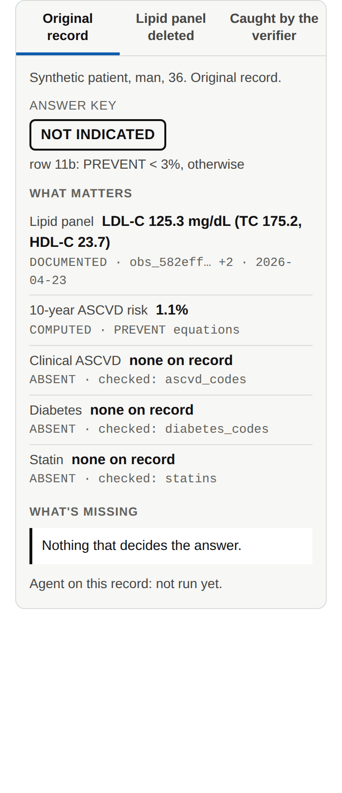

# gapcheck

A care-gap agent that checks its own work.

<!-- USER: your own sentences here if you want them (what it is; after the test, the primary result) -->



<!-- PUBLISH: page URL -->
[Page](PAGE_URL) · [Protocol](PROTOCOL.md) · [Design](SPEC.md) · [Reproduce](docs/REPRODUCE.md)

**Status:** the protocol is a draft and has not been released, so the test set does not exist and there are no test results. [RUNS.md](RUNS.md) logs each step when it happens.

## How it works

1. **Reads.** The agent queries a patient's longitudinal record with tools (labs, diagnoses, medications, notes) and computes 10-year risk with the PREVENT equations.
2. **Claims.** It answers with a status and a list of claims. Each claim cites a record row, a computation, or a confirmed absence.
3. **Gets checked.** Code re-reads every cited row, recomputes every risk and re-runs every "not on record" query. A failed claim sends the draft back once; if it fails again, no alert is shown. The verifier never sees the answer key. It checks facts and arithmetic, not judgment.

## How it is tested

Each base patient is a synthetic longitudinal record (Synthea v4.0.0, with the patches listed in [SPEC sec. 4.1](SPEC.md#41-known-synthea-limits-measured-at-day-0-9862-adults-aged-3079-and-patches)). Each edited twin changes one thing in that record. Ground truth is the 2026 ACC/AHA dyslipidemia guideline written as a decision table in code, with the quoted sentence behind every row ([reports/oracle_rules.md](reports/oracle_rules.md)), plus a ledger of every edit. No LLM grades any output.

| Edit | Correct answer |
|---|---|
| *Edits that must change the answer* | |
| C1: deciding input deleted (lipid panel, systolic BP or smoking status) | CANNOT_DETERMINE, naming the deleted input |
| C3a: reason for not prescribing, stated only in a note | DOCUMENTED_REASON |
| C5: one value moved across a threshold | the new label |
| *Edits that must not change it* | |
| C2a: input deleted where an earlier row makes it irrelevant | unchanged |
| C2b: smoking status deleted where both values give the same label | unchanged |
| C3b: the same reason sentence where no statin is indicated | unchanged |
| C4: distractor in a note (negation, a relative's statin, a deferral, stable liver tests) | unchanged |

C0 is the unedited record. Systems: R0 (the oracle on structured data only), R1 (R0 plus keyword rules on notes), L1 (one model call on the serialized record), A1 (a tool-using agent) and A2 (A1 plus a code verifier that re-checks every cited source and computed risk). The primary outcome, analysis and hypotheses are fixed in [PROTOCOL.md](PROTOCOL.md) before the test set is drawn.

## Bugs found in the data source, fixes sent upstream

Synthea is the open-source generator behind the synthetic patients (status at the time of writing; see each link):
- [synthetichealth/synthea#1794](https://github.com/synthetichealth/synthea/pull/1794): patients with hypertension never got a kidney-function result; the wellness check tested a diagnosis code that no module has created since 2019.
- [synthetichealth/synthea#1795](https://github.com/synthetichealth/synthea/pull/1795): kidney function was one CKD stage off, and end-stage patients got normal values (from the discussion in [#1793](https://github.com/synthetichealth/synthea/issues/1793)).
<!-- PUBLISH: add PR 2 and PR 3 only after they are posted -->

<!-- USER: 1-2 sentences -->

## Limits

- Synthetic patients (Synthea v4.0.0) with disclosed patches. The mix of test cases is designed, so no count is a prevalence.
- Ground truth is the guideline as encoded in a decision table, not clinical judgment. GAP is a prompt for review, not a finding of poor care.
- Notes are templated and favor keyword rules; lipid and eGFR values are generator values. Research prototype, not medical advice.

The full list is in [SPEC sec. 11](SPEC.md#11-limits-fixed-text-for-readme-dashboard-and-write-up).

## Reproduce

```
make setup test        # Python 3.12 and locked packages via uv; unit tests on a small fixture
make tools             # JDK 17.0.21 and the Synthea v4.0.0 jar, sha256-checked
make reproduce verify  # dev set: Synthea, patches, gate, cases, R0/R1 and mock runs, scores
```

Steps, requirements and expected hashes: [docs/REPRODUCE.md](docs/REPRODUCE.md). Run logs and reporting: [RUNS.md](RUNS.md), [DEVIATIONS.md](DEVIATIONS.md), [docs/TRIPOD-LLM.md](docs/TRIPOD-LLM.md). Real model runs are a separate target that reads a backend config: `make run-llm BACKEND=configs/<file>.json RUN_ID=<id>` (example: [configs/vllm_example.json](configs/vllm_example.json)).

## Prior work

None of the parts is new on its own. This project extends counterfactual evaluation of clinical agents (Turk 2026) to one preventive-care decision, with edits that must not change the answer next to edits that must, and ground truth computed by code.

- Turk 2026. Counterfactual Evaluation Reveals Hidden Capability Profiles in Clinical LLMs and Agents. arXiv:2605.30590.
- CliniCARE-Bench. arXiv:2608.07796.
- AgentAbstain. arXiv:2607.10059.
- DeVisE. arXiv:2506.15339.
- MedAgentBench (arXiv:2501.14654); PhysicianBench (arXiv:2605.02240).
- Sarraju et al. Commun Med 2022;2:88. Gobbel et al. Am J Prev Cardiol 2022;9:100300.
- Blumenthal RS, et al. 2026 ACC/AHA/AACVPR/ABC/ACPM/ADA/AGS/APhA/ASPC/NLA/PCNA Guideline on the Management of Dyslipidemia. J Am Coll Cardiol 2026;87(19):2624-2757.
- Khan SS, et al. Development and validation of the American Heart Association's PREVENT equations. Circulation 2024;149(6):430-449.

## AI use

Code was written with AI coding agents; the design, protocol and review are mine.

## License and data

<!-- USER: confirm the license and add a LICENSE file (pyproject.toml says MIT) -->
Generated data is synthetic (Synthea, whose output is public domain per the Synthea wiki; Synthea itself is Apache-2.0).

## Contact

<!-- USER: name, degree, one line, contact -->
